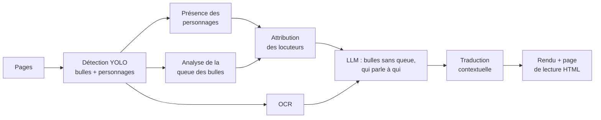
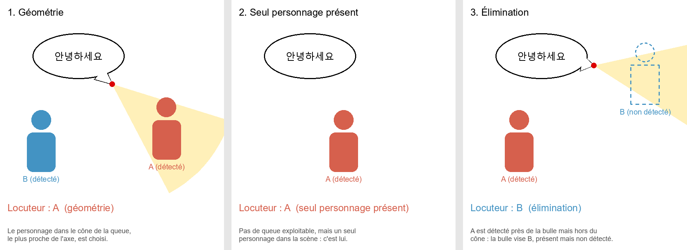

# webtoon-translator

Traduction automatique de webtoons coréens vers le français, **avec attribution des dialogues** :
pour chaque bulle, le programme cherche *qui parle* et *à qui*, afin de choisir entre « tu » et
« vous » et de respecter le ton de chaque personnage.

> Projet personnel (2025 – 2026), en Python : vision par ordinateur (YOLOv8, OpenCV),
> OCR (Google Cloud Vision) et modèle de langage (Gemini).

## Pourquoi ce projet

Traduire le texte d'une image est aujourd'hui facile. Ce qui reste difficile dans une bande
dessinée, c'est le **contexte** : la même phrase coréenne se traduit différemment selon qu'un
élève parle à son professeur ou à un ami. Le cœur du projet est donc une **chaîne de décision**
qui attribue chaque bulle à un locuteur, en combinant des indices visuels fiables et, en dernier
recours seulement, un modèle de langage.

## Fonctionnement



1. **Vision** : les pages, souvent très hautes, sont découpées en panneaux sur les gouttières,
   puis YOLOv8 détecte les bulles (avec queue, sans queue, narration) et les personnages.
2. **Présence** : chaque personnage reçoit un score de 0 à 3 qui diminue progressivement quand
   il n'est plus détecté, pour compenser les oublis du détecteur d'une case à l'autre.
3. **Queue des bulles** : un modèle de segmentation donne le contour de la bulle ; la pointe de
   la queue est le sommet convexe le plus aigu, et sa direction part de la base vers la pointe.
4. **Attribution des locuteurs** : décision hiérarchique (détails ci-dessous).
5. **Texte** : OCR, puis le LLM classe les bulles sans queue (pensée ou parole hors champ),
   complète les locuteurs inconnus et les interlocuteurs, et traduit page par page avec un
   résumé de l'histoire mis à jour au fil des pages.
6. **Rendu** : le texte coréen est recouvert et remplacé par la traduction, avec une taille de
   police adaptée à chaque bulle ; une page HTML permet de lire le chapitre en défilement.

## Attribution des locuteurs



*Figure générée par `webtoon-translator --figure` : les décisions affichées sont calculées par
le code du projet, pas dessinées à la main.*

Les règles sont appliquées dans l'ordre ; la première qui conclut l'emporte :

| Règle | Principe |
|---|---|
| **1. Géométrie** | Un cône part de la pointe de la queue. Parmi les personnages dans le cône, on choisit celui qui minimise `distance / d_max + 2 × écart_angulaire / angle_max`. |
| **2. Seul présent** | Si un seul personnage est dans la scène (score de présence ≥ 2), c'est lui. |
| **3. Élimination** | Deux personnages A et B dans la scène, seul A est détecté, A est proche de la bulle mais hors du cône : la bulle vise donc B. |
| **4. LLM** | Sinon, le modèle de langage choisit parmi les personnages présents, d'après le ton (registre familier ou honorifique) et les fiches personnages. |

Le LLM **ne peut pas remplacer** un locuteur trouvé par les règles 1 à 3 : il ne fait que
compléter. Chaque bulle garde la trace de la règle qui l'a attribuée (`speaker_source`), ce qui
permet d'évaluer chaque méthode séparément (voir *Évaluation*).

## Installation

Python 3.11 ou plus récent.

```powershell
git clone https://github.com/matteoroncelay/webtoon-translator.git
cd webtoon-translator
python -m venv .venv
.venv\Scripts\Activate.ps1        # Linux / macOS : source .venv/bin/activate
pip install -e ".[dev]"
copy .env.example .env            # puis renseigner la clé Gemini
webtoon-translator --check
```

Il faut aussi :
- **les modèles YOLO** dans `models/` : voir [models/README.md](models/README.md) pour les entraîner ;
- **un accès Google Cloud Vision** : `gcloud auth application-default login`, ou un compte de
  service via `GOOGLE_APPLICATION_CREDENTIALS` ;
- **les fiches personnages** de la série dans `config/characters.json`
  (modèle : [config/characters.example.json](config/characters.example.json)).

Le modèle de personnages et les fiches sont optionnels : sans eux, l'attribution est entièrement
confiée au LLM.

## Utilisation

```powershell
webtoon-translator --translate data\chapitre-1            # résultat dans outputs\chapitre-1\
webtoon-translator --translate data\chapitre-1 --resume   # reprendre après une interruption
webtoon-translator --debug-vision data\chapitre-1         # visualiser bulles et queues détectées
```

Le dossier de sortie contient `lecture.html` (le chapitre traduit), `pages/` (les images),
`chapter.json` (l'état complet, sauvegardé après chaque étape) et `rapport.csv`.

Tous les réglages (seuils, cône, présence, lots envoyés au LLM, rendu…) sont dans
[config/default.yaml](config/default.yaml). Pour en modifier certains, créer un fichier YAML ne
contenant que ces clés et le passer avec `--config`.

## Évaluation

`rapport.csv` liste chaque bulle avec la règle qui l'a attribuée. Après avoir rempli la colonne
`correct` (1 ou 0) à la main :

```powershell
webtoon-translator --evaluate outputs\chapitre-1\rapport.csv
```

donne la précision de chaque règle (géométrie, élimination, LLM…).

## Structure

```
src/webtoon_translator/
├── config.py        configuration typée (YAML) et secrets (.env)
├── models.py        structures de données : BBox, Bubble, Page, Chapter
├── io/              lecture/écriture des images, état du chapitre, rapport CSV
├── vision/          panneaux, détection YOLO, analyse de la queue des bulles
├── reasoning/       présence des personnages, attribution des locuteurs
├── text/            OCR, client Gemini, classification, contexte, traduction
├── render/          écriture du texte dans les bulles, page HTML
└── pipeline.py      enchaînement des étapes, reprise après interruption
```

## Tests

```powershell
pytest
```

Les tests n'utilisent ni modèle ni réseau : la logique de décision est vérifiée sur des scènes
construites à la main, l'analyse des queues sur des bulles dessinées par le programme, et le
pipeline complet avec de faux composants (détecteurs, OCR et LLM simulés).

## Limites connues

- Les modèles YOLO ont été entraînés sur peu d'images annotées ; le modèle de personnages ne
  reconnaît que les personnages de la série sur laquelle il a été entraîné.
- L'analyse de la queue dépend de la qualité de la segmentation : elle échoue surtout sur les
  queues très courtes ou collées à une autre bulle.
- Le texte original est recouvert d'un fond blanc, et non effacé par reconstruction de l'image :
  le rendu est moins propre sur les bulles colorées ou transparentes.
- La qualité finale dépend de l'OCR et du LLM, qui peuvent se tromper sur un texte stylisé.
- Le poids des règles de la géométrie (cône, distances, coefficients) a été réglé à la main,
  et non optimisé sur un jeu de données annoté.
